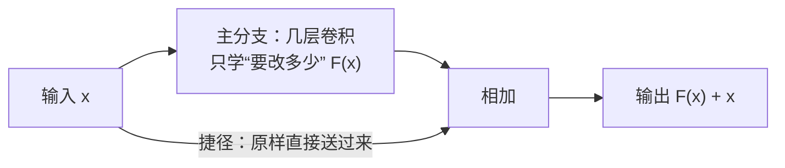

### 1.环境
### 2.resnet
#### 2.1 代码

这就是resnet的思路，和我们上面的讨论有重合  
但是resnet被提出，其实是为了解决另一个问题  
经过前面的学习，我们已经知道网络层数加深，按道理说层数越深那么学到的东西也应该越多，最后预测的越准，但是实际情况不是这样，比如一个20层，已经训练的很好的模型，如果加深到56层，最后结果至少不应该比20层的模型差，但是实验出来是这样的：  
  
这不是过拟合，加深层数后模型在训练集和测试集上的表现都降低了，这就很奇怪，我们想要的层数加深的结果是这样的：“如果到了某个层数，已经很好了，那么后面的层的训练，如果不能更好，请至少保持原样”，但是普通的cnn貌似不能满足，上图已经说明，所以我们就需要找一个“恒等映射”（也就是输入等于输出）（好多知乎文章都这么说，但是我觉得最后学出来的残差不只是恒等映射，还起到了更新的作用），但是这在模型中很难办到，毕竟涉及到了好多参数的联动，于是我们干脆直接让他学习“变化”（残差），然后再把输入特征加进去，最后得到输出，这样的好处是，如果这一层不需要优化，模型可以通过学习学出来0（这至少比调整一串参数容易），让输入近似等于输出，也就是说，经过这样的操作，我们有希望达成“请至少不要退化”的目的，至于具体实现请看下图：  
  
这样做还有其他好处，比如加法，导数出来了1（尽管归一化已经限制了数据范围，但是无法保证求梯度的时候会出来很小的数或很大的数，毕竟链式法则是惩罚），最后求梯度的时候会减少梯度消失的情况（不保证一定）  
用数学抽象一下就是这样：  
恒等映射：  
$$
H(x) = x
$$
残差：  
$$
F(x) = H(x) - x
$$
输出：  
$$
H(x) = F(x) + x
$$
也就是说，如果这一层没有取得更好的更新，优化器优化的时候会让$F(x)$趋于零，有了更好的更新就继续下去
需要注意的是，这里的残差不是我们需要的“雨层”之类的，毕竟通道数都不一样  
至于这里为什么适合resnet，有以下原因：  
1. 网络在处理图象时，既要学习新特征，也要尽量避免丢失原有特征，这是shortcut天然能达到的  
2. 同样，这里的shortcut帮助了我们进行优化，使得网络层数更深成为了可能，感受野也有希望随之扩大，帮助网络更好的识别雨丝或是其他细节特征  

具体代码如下：  
```python
import torch.nn as nn

class BaselineNet(nn.Module):
    def __init__(self):
        super(BaselineNet, self).__init__()
        self.conv1=nn.Conv2d(3,64,3,1,1)
        self.bn1=nn.BatchNorm2d(64)
        self.relu=nn.ReLU()
        block_list=[]
        for i in range(6):
            block_list.append(
                nn.Sequential(
                    nn.Conv2d(64,64,3,1,1),
                    nn.BatchNorm2d(64),
                )

            )# relu加在了后面
        self.blocks=nn.Sequential(*block_list)
        self.shortcut=nn.Identity()
        self.conv8=nn.Conv2d(64,3,3,1,1)

    def forward(self, x):
        initial_rained=x
        x=self.conv1(x)
        x=self.bn1(x)
        x=self.relu(x)
        for block in self.blocks:
            identity=self.shortcut(x)
            x=block(identity)
            x=self.relu(x+identity)
        rain_layer=self.conv8(x)
        rain_removed=initial_rained-rain_layer
        return rain_removed
```  
#### 2.2 问题
其实题目里的两个问题我都已经在查询resnet的相关资料的时候已经碰见了：  
关于梯度消失，resnet使得梯度计算时出现了$F(x)+x$使得导数始终会有一个1，最后计算的时候梯度几乎总是在1附近震荡，梯度消失的问题得到了缓解，但是不能保证解决，模型里一般还会加上归一化，使得数据的范围发生了变化，这里也是在约束导数，尤其是链式法则出现相乘的时候  
关于训练困难，主要的困难集中在我一开始的问题：如果更深层不能有效更新，请至少保持原样（也就是如何防止退化）。就这个恒等映射，由于涉及到了参数的联动，所以很难学习出来这个映射，所以我们引入了残差，不能有效更新的时候还不如让$F(x)$趋近于0，以此来保持原样，至少不会退化  
#### 3.代码  
1. 关于模型的写法  
    中间有很多层是“重复”的，所以一开始就想着用for循环遍历的写，如下：  
    ```python
    class BaselineNet(nn.Module):
    def __init__(self):
        super(BaselineNet, self).__init__()
        self.conv1=nn.Conv2d(3,64,3,1,1)
        self.bn1=nn.BatchNorm2d(64)
        self.relu=nn.ReLU()
        block_list=[]
        for i in range(6):
            block_list.append(Conv2d(3,64,3,1,1))
            block_list.append(nn.BatchNorm2d(64))# relu加在了后面
        self.blocks=nn.Sequential(*block_list)
        self.shortcut=nn.Identity()# 一般是用shortcut作为统一接口，如果出现通道数不一样的情况（后续无法相加），就可以用self.shortcut=(nn.Conv2d())来调整，这里的identity就是指什么也不干，输出原样
        self.conv8=nn.Conv2d(64,3,3,1,1)

    def forward(self, x):
        x=self.conv1(x)
        x=self.bn1(x)
        x=self.relu(x)
        for block in self.blocks:
            identity=self.shortcut(x)
            x=block(identity)
            x=self.relu(x+identity)
        x=self.conv8(x)
        return x

    ```
    但是这样有个问题，`*block_list`解包的时候会把这些东西全部当成单独一个层而不是当成一个块，也就是12层传播而非6块传播，并没有达到shortcut的目的（这是受前几个模型的影响，毕竟前几个我就是这么扩展列表然后解包），于是我便改进，将这两层打包放进`nn.Sequential`这样解包的时候就不会分成12层了，而是会分成6块，如下：  
    ```python
    block_list=[]
        for i in range(6):
            block_list.append(
                nn.Sequential(
                    nn.Conv2d(64,64,3,1,1),
                    nn.BatchNorm2d(64),
                )

            )
    ```
2. 关于命令行参数  
命令行参数的一个很明显的好处就是不用再去改代码里的设置了  
首先是题目中给出的代码：  
```python
python main.py --data_dir "你的数据集地址" --model baseline --mode train --epochs 100
```  
字面意思就是：  
|python| main.py| --data_dir|--model | --mode| --epochs|
|---|---|---|---|---|---|
|调用该环境里的python解释器|运行main.py文件|数据集地址|模型选择|模式|轮次|
这里的参数设置对应main函数里的这几行：  
```python
import argparse
def get_args():
    parser = argparse.ArgumentParser(description="Deraining Model Training")
    parser.add_argument("--data_dir", type=str, required=True, help="Path to the dataset")
    parser.add_argument("--model", type=str, default="baseline", choices=["baseline", "unet"], help="Model to use")
    parser.add_argument("--mode", type=str, default="train", choices=["train", "test"], help="Train or test mode")
    parser.add_argument("--epochs", type=int, default=20, help="Number of training epochs")
    return parser.parse_args()


```
这里首先导入`argparse`模块，用于解析命令行参数，然后就是函数体，里面先是实例化了一个`ArgumentParser`类并赋给`paser`，使得`paser`这个对象能够处理命令行里的参数，最后返`return`里的`parser.parse_args()`则是把命令行里的参数保存下来，最后的调用的方法大概如下：  
```python
args = get_args()
if args.model == "baseline":
    model = BaselineNet().to(device)

```  
其中的`add_argument()`方法是来定义支持那些命令行参数以及这些参数都该怎么处理    
至于这里涉及到的参数，见如下表格： 
| 参数 | 作用 | 
|---|---|
|命令行参数名称|""里面的内容，一般加上`-`或者`--`来表示可选参数，否则就是位置参数，这两个的详细区别见下表|
|type|转换成指定类型|
|choices|限制允许输入的值|
|required|是否必须传参|
|default|默认值|
|help|附加说明（description也会出现在`python main.py --help `中）|  
 
关于位置参数和可选参数：  

   
| |位置参数|可选参数|
|---|---|---|
|核心区别|没有`-`或者`--`|有`-`或者`--`|
|是否必须传|是|否|
|是否必须按顺序传|是|否|